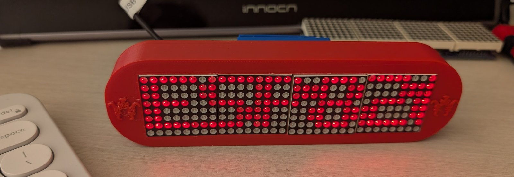
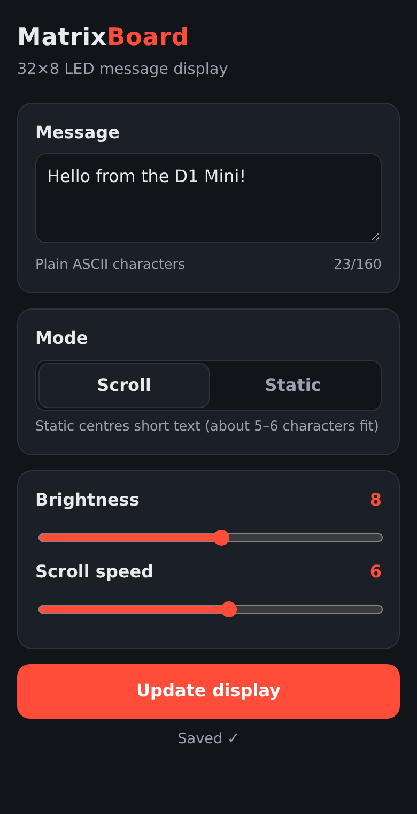

# esp8266-matrix-ap

<p align="center">
  
</p>

A standalone Wi-Fi message board for a **Wemos D1 Mini (ESP8266)** and a **4-in-1 MAX7219 32×8 LED matrix**.

The board creates its own Wi-Fi access point. It needs no router and no internet. Join its network from your phone, and a captive portal opens the control page. From there you can change the message, brightness, scroll speed and display mode. Settings are saved to flash and restored after a power cycle.

## Screenshot

<p align="center">
  
</p>

This is the control page after typing a message, choosing **Scroll**, setting brightness to 8 and speed to 6, then pressing **Update display**. The board applies the change at once and replies with the saved state, and the page then shows **Saved ✓**.

The screenshot was taken with the [mock server](#testing-the-web-page-without-hardware), which prints what the matrix would show for each update:

```
[web] POST /set ['bri', 'mode', 'msg', 'spd']
  ┌──────────────────────────────────┐
  │ Hello from the D1 Mini!          │  SCROLL 76ms/frame
  └──────────────────────────────────┘  bri  8 [#########.......]
```

## Features

- **Standalone SoftAP.** No external network required. The control page is served at `192.168.4.1`.
- **Captive portal.** A DNS catch-all makes phones open the control page as soon as they connect.
- **Offline-first web UI.** A mobile-friendly page stored in `PROGMEM`, with no CDNs or external assets.
- **Smooth, non-blocking animation.** Uses [MD_Parola](https://github.com/MajicDesigns/MD_Parola) and [MD_MAX72XX](https://github.com/MajicDesigns/MD_MAX72XX).
- **Scroll or static modes.** Scroll a long message, or centre a short word on the display.
- **Persistent settings.** Saved to LittleFS. Writes are delayed until changes settle, so dragging a slider doesn't wear out the flash.
- **Low-fragmentation design.** The display text lives in fixed-size `char` buffers. `loop()` creates no `String` objects.
- **Development tools.** A wiring-finder diagnostic firmware, and a Python mock server for testing the web page without hardware.

## Hardware

| Part | Notes |
|------|-------|
| Wemos D1 Mini (ESP8266) | Or any D1 Mini clone with a CH340 or CP2104 USB chip |
| 4-in-1 MAX7219 8×8 LED matrix module | FC16-style (the common blue PCB with four chips in a row) |
| 5 jumper wires | Female–female for most modules |
| USB cable + 5 V supply | At full brightness the matrix can draw several hundred mA |

### Wiring

| D1 Mini pin | MAX7219 pin | Notes |
|-------------|-------------|-------|
| **5V**      | VCC | Must be 5 V, not 3V3 |
| **G**       | GND | |
| **D7** (GPIO13) | DIN | Hardware SPI MOSI (fixed) |
| **D5** (GPIO14) | CLK | Hardware SPI SCK (fixed) |
| **D6** (GPIO12) | CS  | Any free GPIO. Set `CS_PIN` in [`src/main.cpp`](src/main.cpp) |

Notes:

- Connect to the module's **input** header. That's the end where DIN is labelled, with the printed arrow pointing away from it.
- **CS pin choice.** D6, D2 and D1 have no boot-time role, so any of them is a good choice. D4 works, but it also drives the on-board LED, which will flicker. **Avoid D8**: it must be low at boot.
- **Logic level.** The ESP8266's 3.3 V signals usually drive a 5 V-powered FC16 module fine. If you see garbage, add a level shifter.
- **Not sure how yours is wired?** Flash the [wiring finder](#wiring-finder-diagnostic) and it will tell you.

## Quick start

Install [PlatformIO](https://platformio.org/install) (the CLI, or the VS Code extension). Then:

```bash
git clone https://github.com/jpdenzer/esp8266-matrix-ap.git
cd esp8266-matrix-ap
pio run -t upload -t monitor
```

The first build downloads the ESP8266 toolchain and libraries, which can take a while. Later builds take seconds. You don't need to upload a file system image. LittleFS is formatted automatically on first boot.

On the serial monitor (115200 baud), you should see:

```
MatrixBoard starting
[fs] no valid settings, using defaults
[fs] mode=0 bri=4 spd=5 len=36 msg="Join Wi-Fi "MatrixBoard" to edit me!"
[wifi] AP "MatrixBoard" up, IP 192.168.4.1
[web] server started on port 80
```

## Usage

1. Power the board. It scrolls a default message.
2. On your phone, join the Wi-Fi network **`MatrixBoard`** (default password **`matrix1234`**).
3. The control page opens automatically. If it doesn't, browse to **http://192.168.4.1**.
4. Set:
   - **Message:** up to 160 characters. Printable ASCII only; other characters show as `?`.
   - **Mode:** *Scroll*, or *Static* (centred; about 5–6 characters fit).
   - **Brightness:** 0–15.
   - **Scroll speed:** 1–10.

Brightness and speed apply as soon as you release the slider. **Update display** sends the message and mode. Changes are saved to flash about 3 seconds after the last edit.

> **Change the default Wi-Fi password** (`AP_PASSWORD`) before you leave the board running somewhere public. Anyone who has read this README knows the default.

## Configuration

All user settings are constants at the top of [`src/main.cpp`](src/main.cpp):

| Constant        | Default        | Purpose |
|-----------------|----------------|---------|
| `CS_PIN`        | `D6`           | MAX7219 chip-select pin |
| `HARDWARE_TYPE` | `FC16_HW`      | Module type. Try `GENERIC_HW`, `PAROLA_HW` or `ICSTATION_HW` if text is mirrored or scrambled |
| `MAX_DEVICES`   | `4`            | Number of chained 8×8 modules |
| `AP_SSID`       | `MatrixBoard`  | Access point name |
| `AP_PASSWORD`   | `matrix1234`   | At least 8 characters, or `""` for an open network |
| `AP_CHANNEL`    | `6`            | Wi-Fi channel |
| `MSG_MAX_LEN`   | `160`          | Maximum message length |
| `SAVE_DELAY_MS` | `3000`         | How long changes must settle before they're written to flash |

## HTTP API

The web page uses a small API that you can also call from scripts while connected to the board's Wi-Fi.

| Method | Path | Description |
|--------|------|-------------|
| `GET`  | `/` | Control page |
| `GET`  | `/api/state` | Current settings as JSON: `{"msg":"…","bri":4,"spd":5,"mode":0}` |
| `POST` | `/set` | Update settings (form-encoded). All fields are optional: `msg`, `mode` (0 = scroll, 1 = static), `bri` (0–15), `spd` (1–10). Add `js=1` to get JSON back. Without it, the server replies with a redirect to `/`. |

All other paths redirect to the control page. This is what triggers the captive portal.

```bash
curl -X POST http://192.168.4.1/set -d "msg=Hello world&mode=0&bri=8&spd=6&js=1"
```

## Development tools

### Wiring finder (diagnostic)

If the display stays blank, flash the diagnostic firmware. It cycles through the likely CS pins, and DIN/CLK both ways round, lighting a different pattern for each combination:

```bash
pio run -e diag -t upload -t monitor
```

Watch the matrix for about 70 seconds:

| What lights up | Meaning |
|----------------|---------|
| **N solid lines** | DIN/CLK are correct. CS is on: 1 = D2, 2 = D1, 3 = D3, 4 = D4, 5 = D8, 6 = D6, 7 = D0 |
| **N dotted lines** | DIN and CLK are swapped. CS is the same as above |
| **Nothing at all** | A power problem (5 V/GND), or the wires are on the output header |

Set `CS_PIN` to match, then flash the main firmware again with `pio run -t upload`.

### Testing the web page without hardware

[`tools/mock_server.py`](tools/mock_server.py) serves the exact page embedded in `src/main.cpp`. It reproduces the firmware's `/api/state` and `/set` behaviour, including clamping and character cleanup. It also prints a rough preview of the display for each change. It needs only Python 3.

```bash
python3 tools/mock_server.py          # open http://localhost:8080
```

Refresh the browser to pick up HTML edits in `main.cpp`. No rebuild is needed. The mock doesn't run the captive portal, DNS server or flash storage.

### Uploading from WSL2

WSL can't see USB devices until you pass them through with [usbipd-win](https://github.com/dorssel/usbipd-win):

```powershell
usbipd list                              # find the board's BUSID (e.g. 1-2, "USB-SERIAL CH340")
usbipd bind --busid <BUSID>              # one time, in an Administrator PowerShell
usbipd attach --wsl --busid <BUSID>      # each time the board is plugged in
```

The board then appears in WSL as `/dev/ttyUSB*`, and `pio run -t upload` finds it automatically. While it's attached to WSL, Windows can't see it. `usbipd detach --busid <BUSID>` gives it back.

## Troubleshooting

| Symptom | Fix |
|---------|-----|
| Display completely blank | Run the [wiring finder](#wiring-finder-diagnostic). Check that VCC is on 5 V and the wires are on the input header |
| Text mirrored, upside down or scrambled | Change `HARDWARE_TYPE` (see [Configuration](#configuration)) |
| Random dots or flicker | Use a shorter cable or a better 5 V supply, or lower the brightness. Add a level shifter on DIN, CLK and CS |
| Captive portal doesn't pop up | Browse to `http://192.168.4.1` manually. Some phones need mobile data turned off |
| Upload fails or no port found | Close any open serial monitor. On WSL, run `usbipd attach` again after replugging |

## Project layout

```
├── docs/images/              # README photo and control-page screenshot
├── platformio.ini            # build envs: d1_mini (default) and diag
├── src/
│   ├── main.cpp              # firmware: AP, captive portal, web UI, display, persistence
│   └── diag/
│       └── wiring_finder.cpp # diagnostic firmware (built only by `-e diag`)
├── tools/
│   └── mock_server.py        # local mock of the web server for UI testing
└── LICENSE
```

## License

[MIT](LICENSE)
